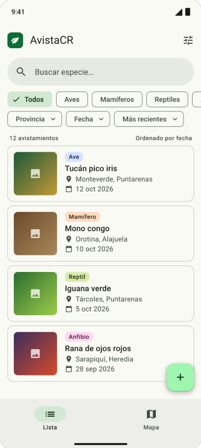
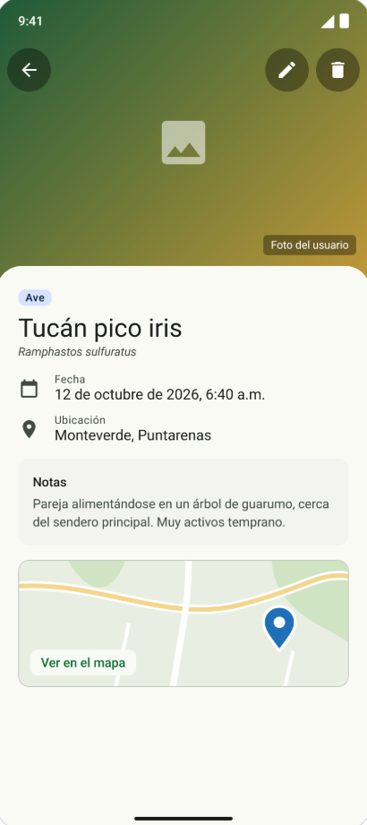
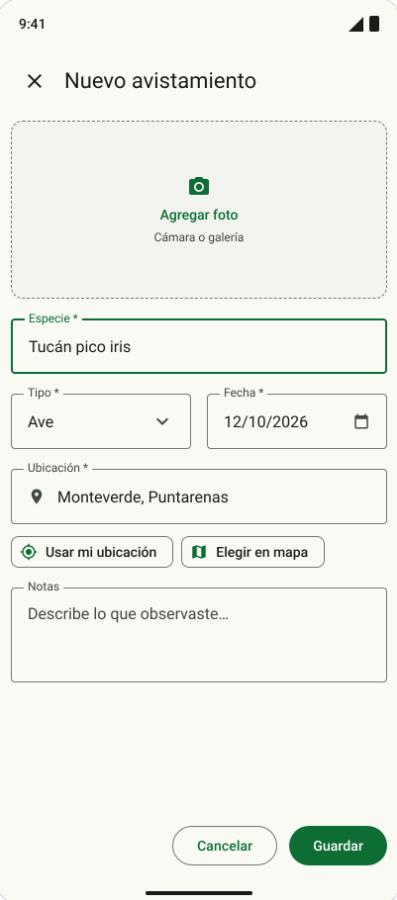
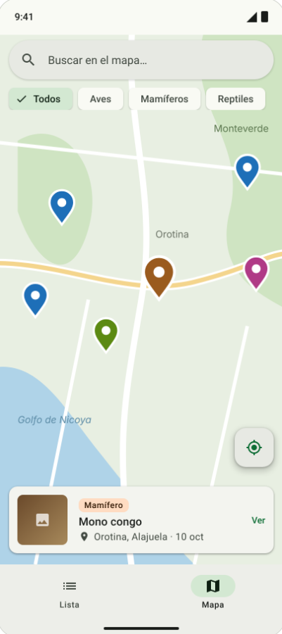
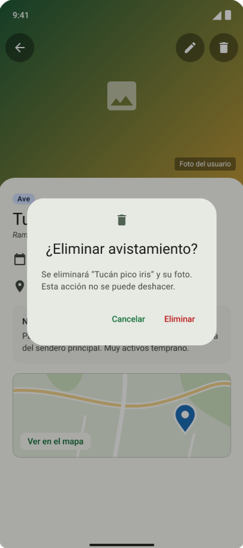
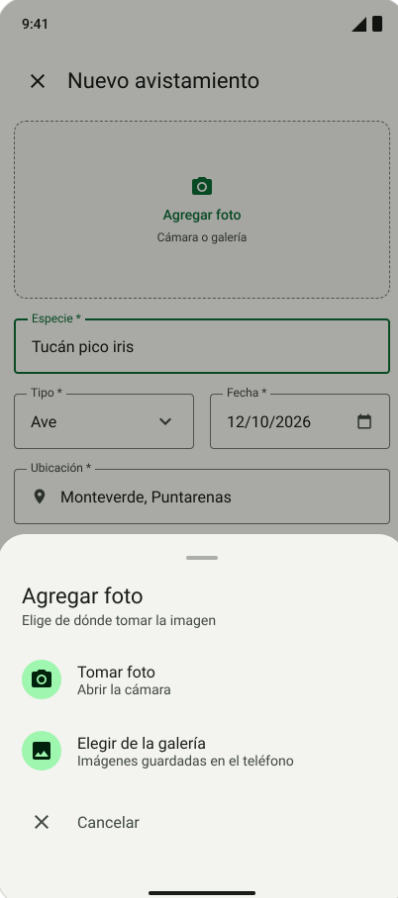

## AvistaCR

Proyecto para el curso de desarrollo de aplicaciones Android - UTN.

## Descripción

AvistaCR es una app para llevar un registro de los animales que uno ve en Costa Rica.
La idea es que cada vez que se vea un ave, un mono, una iguana o cualquier otro animal,
pueda guardar el avistamiento con una foto, el lugar donde lo vi, la fecha y algunas notas.

Los avistamientos se pueden ver en una lista, filtrar por tipo de animal, provincia o fecha,
y también verlos todos en un mapa.

## Integrante

Saray Castillo

## Funcionalidades

- Agregar, ver, editar y eliminar avistamientos.
- Lista con filtros por tipo de animal, provincia y fecha, además de un buscador.
- Tomar la foto con la cámara o elegirla de la galería.
- Mensaje de confirmación antes de eliminar y opción para escoger entre cámara o galería.
- Mapa con la ubicación de cada avistamiento. Al registrar uno se puede usar la ubicación
  actual o marcarla en el mapa.

## Mockups

Los diseños se hicieron siguiendo Material Design 3, que es la guía de diseño de Android.

Pantalla principal (lista), detalle y formulario:

  

Mapa y diálogos:

  

Algunas decisiones de diseño que tomé:
- La barra de abajo permite cambiar rápido entre la lista y el mapa.
- Los filtros están siempre visibles arriba de la lista para no tener que buscarlos en un menú.
- Cada tipo de animal tiene su color y se usa el mismo en la lista y en los pines del mapa.
- Antes de eliminar se pide confirmación, porque no se puede deshacer.

